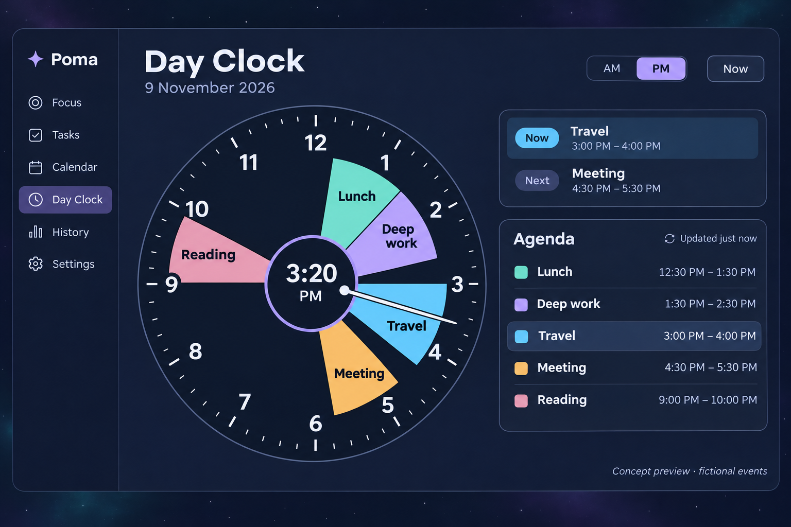

# Day Clock visual direction

Selected on 9 November 2026 following the owner's 12-hour clock reference and request for colours that suit Poma's universal star background. This records a design direction, not a completed app feature.

The owner's latest request also includes **Add task from Day Clock to Google Calendar**, for example 10:00–11:00 PM. Read [the current feature brief](DAY_CLOCK_FEATURE_BRIEF.md) for the creation form, permission boundaries, save/recovery behavior and acceptance criteria. The earlier read-only-only Day Clock scope is superseded; the existing focus writer keeps its own ownership boundaries.

The concept uses fictional events. It was generated with the built-in image tool using the owner's [clock reference](design/day-clock-reference.png); the [final generation prompt](design/day-clock-concept.prompt.txt) is preserved alongside it. It illustrates composition and colour; the Flutter implementation must establish exact geometry, text layout, accessibility and behavior through actual rendering and verification.

**Clock structure**

Use the reference's recognizable 12-hour analog layout and substantial filled event sectors extending from the central time disc toward the perimeter. Keep 12 at the top, 3 right, 6 bottom and 9 left. Separate simultaneous events into radial lanes as necessary. This selected direction refines the earlier generic concentric-ring suggestion: ordinary non-overlapping events should read as substantial clock sectors.

Use an explicit AM/PM switch. Show one half-day at a time and clip crossing events to that half. The default follows today and the current half-day; manual browsing stays stable until Now is selected. A single contrasting schedule hand shows the actual time on that same 12-hour scale only in the current real half-day. Use a small hub and position the central digital time so it remains clear of the hand.

**Palette**

Reuse Poma's existing background, reading-surface and text tokens. The new dial surface and example event accents below are the proposed dark appearance; final values must pass contrast and high-contrast verification.

| Role | Colour | Hex |
| --- | --- | --- |
| Existing star background | Midnight navy | `#0D1528` |
| Existing reading panels / clock centre | Deep blue | `#18233B` |
| Dial face | Ink navy | `#111C31` |
| Primary text | Soft white | `#EDF2FF` |
| Secondary text | Blue grey | `#B8C5DC` |
| Current-time hand | Pearl white, with dark outline | `#F4F7FF` |
| Selected control / centre accent | Lavender | `#B9A7FF` |
| Event accent 1 | Lavender | `#B9A7FF` |
| Event accent 2 | Mint teal | `#64D8CB` |
| Event accent 3 | Sky cyan | `#6CCBFF` |
| Event accent 4 | Warm amber | `#F2C078` |
| Event accent 5 | Soft rose | `#E89AB5` |
| Text on the light event accents | Dark navy | `#101B30` |

These event accents are the recommended Poma defaults and fictional-preview colours. Preserve support for explicit Google event colours and the established source-calendar fallback. Do not silently replace assigned Google colours just to make a schedule match this illustration. If a themed recolouring option is later introduced, make it an explicit setting.

Retain Poma's sparse still stars and subtle violet/teal background washes. Keep the dial and reading panels opaque so stars do not interfere with text. Let event sectors supply the colour within the clock; use a restrained lavender centre outline and a neutral high-contrast hand.

**Composition and readability**

Use Sora for headings and clock numerals and Source Sans 3 for controls and agenda text. Inherit current spacing, corners, reading widths and control sizing. The concept's exact font sizes and panels are illustrative; production must follow the existing theme and responsive constraints.

On wide windows, a generous dial sits beside the current/next summary and chronological agenda. On narrow windows or enlarged text, these stack and remain scrollable. Keep full event titles and times in the agenda; place short labels within sectors only when they fit. Use event outlines and readable labels in addition to colour. Preserve the current light and system high-contrast themes through explicit equivalent treatments.

The three implementation sessions should read this direction alongside the research and design-system documents. Session 1 establishes the actual Flutter appearance; Session 2 connects the real calendar behavior; Session 3 renders, inspects and refines the finished feature. The concept image is a design reference, not visual or functional acceptance evidence.
